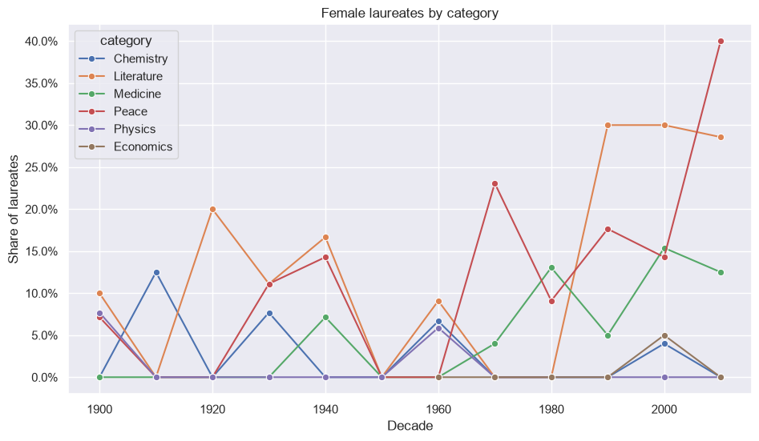

# A visual history of Nobel Prize winners

Explores the Nobel Foundation's list of laureates from 1901 to 2016: country of birth, gender balance, repeat winners and age at award.



## Data

`datasets/nobel.csv`: one row per prize share. The data comes from the DataCamp project of the same name.

## Key results

- US-born laureates went from about 2% of winners in the 1900s to 42% in the 2000s.
- 49 of 885 individual prize shares went to women; Physics (1.0%) and Economics (1.3%) are the most unbalanced categories.
- Laureates are getting older: average age at award was 58 in the 1900s and 66 in the 2000s.

## Running the notebook

```bash
pip install -r requirements.txt
jupyter notebook notebook.ipynb
```

## License

The code is released under the [MIT License](LICENSE). Datasets keep the terms of their original sources, described above.
